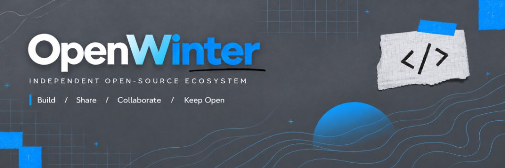

<p align="center">
  
</p>

<h1 align="center">OpenWinter</h1>

<p align="center">
  <b>Independent Open-Source Ecosystem</b><br>
  <i>Build · Share · Collaborate · Keep Open</i>
</p>

<p align="center">
  <a href="https://openwinter.dev"><b>🌐 openwinter.dev</b></a> ·
  <a href="#-active-projects">Projects</a> ·
  <a href="#-engineering-principles">Principles</a> ·
  <a href="#-core-stack">Tech Stack</a> ·
  <a href="#-community--connect">Community</a> ·
  <a href="#-contributing">Contributing</a>
</p>

---

## ❄️ About OpenWinter

OpenWinter is an independent open-source engineering collective dedicated to building **sovereign developer tools, autonomous community infrastructure, and resilient decentralized systems**.

We believe software should be **open-source by default, zero-telemetry by principle, and lightweight by design**. Our projects empower developers, builders, and technical communities to operate their own infrastructure without surveillance, vendor lock-in, or subscription moats.

---

## 🚀 Active Projects

| Repository | Description | Primary Stack | Status |
| :--- | :--- | :--- | :---: |
| **[⚡ SirDeep](https://github.com/opensourcewinter/sirdeep)** | Autonomous community engine & AI companion for developer Discord guilds with 24/7 coding radio, anti-nuke audit sentinels, and dynamic PIL cards. | `Python 3.11+` `Discord.py` `FFmpeg` `Ollama` | [](https://github.com/opensourcewinter/sirdeep/releases) |
| **[🕸️ WinterGrab](https://github.com/opensourcewinter/wintergrab)** | Friendly, high-throughput web scraping engine that scales from single pages to large-scale adaptive crawls with browser-like fetching. | `Python` `Asyncio` `Scraping Engine` | [](https://github.com/opensourcewinter/wintergrab) |
| **[💬 WinterChat](https://github.com/opensourcewinter/winterchat)** | Decentralized messaging architecture built for privacy, cryptographic peer-to-peer transmission, and developer communication. | `Distributed Systems` `E2EE` `Async` | [](https://github.com/opensourcewinter) |

---

## 🏛️ Engineering Principles

* **Zero Telemetry**: Our software contains no third-party tracking, no advertising SDKs, and no telemetry beacons. Your data stays on your machine.
* **Self-Hostable First**: Every tool is architected to run seamlessly on commodity hardware, home labs, or Docker containers with zero cloud dependencies.
* **Low-Latency & Resource Efficient**: We optimize for minimal memory footprints, non-blocking asynchronous I/O, and hardware acceleration.
* **Radical Transparency**: All public repositories are licensed under permissive open-source licenses (MIT) and welcome global contributions.

---

## 🛠️ Core Stack

```
Languages       │ Python 3.11+ • TypeScript • Rust • C++
Runtimes        │ Docker • Node.js • Linux Native Daemons
AI & Inference  │ Ollama Local GPU • OpenRouter • Gemini • OpenAI
Audio & Media   │ FFmpeg 9.0+ • Pillow (PIL) High-DPI Engine
Data & State    │ SQLite (WAL Mode) • Redis • JSON Dataclasses
```

---

## 🤝 Community & Connect

OpenWinter is driven by builders who value open technology, collaborative problem-solving, and minimalist craft.

* 🌐 **Official Website**: [openwinter.dev](https://openwinter.dev)
* 🐙 **GitHub Organization**: [github.com/opensourcewinter](https://github.com/opensourcewinter)
* 💬 **Discord**: Join our community of builders, contribute to active repositories, and test our flagship bots live in our guild.
* ⚡ **Flagship Bot**: Explore [SirDeep](https://github.com/opensourcewinter/sirdeep) for developer community orchestration.

---

## 💡 Contributing

We welcome pull requests, architectural feedback, and bug reports across all our repositories:

1. **Find a Project**: Check the issues board in [SirDeep](https://github.com/opensourcewinter/sirdeep/issues) or [WinterGrab](https://github.com/opensourcewinter/wintergrab/issues).
2. **Branch & Build**: Follow the Conventional Commits specification.
3. **Submit a Pull Request**: Help us keep technology open and free for everyone.

<p align="center">
  <sub>© 2026 OpenWinter Foundation. Built with ❄️ by developers, for developers.</sub>
</p>
